# Guía de la app Finisher Legacy

Recorrido paso a paso de la app móvil para el **dueño**, el **equipo de
soporte** y los **revisores de las tiendas** (Google Play y App Store).

> **Sobre las capturas.** Se tomaron el 20 de noviembre de 2026 en un emulador
> de Android, con la app en español y una cuenta de prueba en un **entorno de
> demostración local**. Los entrenamientos, recuerdos, medallas, mensajes de
> ánimo, la tarjeta de ánimo, el pedido y el familiar son datos de ejemplo
> creados solo para esta guía. Los precios que aparecen (por ejemplo, la
> tarjeta de ánimo a $249 MXN) son **de ejemplo**: los precios reales los
> decide el dueño.
>
> Lo que necesita hardware real o credenciales está marcado con 🔧. En esos
> casos mostramos la pantalla tal como aparece, sin simular resultados:
>
> - 🔧 **NFC**: activar un Tag o una tarjeta de ánimo requiere un teléfono con NFC y un chip real.
> - 🔧 **GPS**: medir distancia al aire libre requiere un teléfono real en exteriores.
> - 🔧 **Pago**: cobrar con tarjeta requiere las llaves de OpenPay (sandbox o producción).

## Contenido

1. [Primeros pasos](#1-primeros-pasos)
2. [Navegación](#2-navegación)
3. [Activar un Finisher Legacy Tag con NFC](#3-activar-un-finisher-legacy-tag-con-nfc)
4. [Mi Legado: recuerdos](#4-mi-legado-recuerdos)
5. [Portarretrato](#5-portarretrato)
6. [Medallas y carreras](#6-medallas-y-carreras)
7. [Modo entrenamiento](#7-modo-entrenamiento)
8. [Mensajes de ánimo](#8-mensajes-de-ánimo)
9. [Tarjeta de ánimo NFC](#9-tarjeta-de-ánimo-nfc)
10. [Familia y ubicación en vivo](#10-familia-y-ubicación-en-vivo)
11. [NIP opcional](#11-nip-opcional)
12. [Comunidad](#12-comunidad)
13. [Tienda (Colecciones)](#13-tienda-colecciones)
14. [Notificaciones y ajustes](#14-notificaciones-y-ajustes)
15. [Para el administrador](#15-para-el-administrador)

---

## 1. Primeros pasos

### Bienvenida y registro

1. Al abrir la app por primera vez aparece la bienvenida. Desliza para ver las
   tres presentaciones.
2. Toca **Crear mi cuenta**.
3. Escribe nombre, apellido, correo y una contraseña de al menos 8 caracteres
   (dos veces).
4. Acepta los Términos y condiciones (incluyen las reglas de la comunidad) y
   el Aviso de privacidad. Puedes leerlos desde los enlaces de abajo.
5. Toca **Crear mi cuenta**.

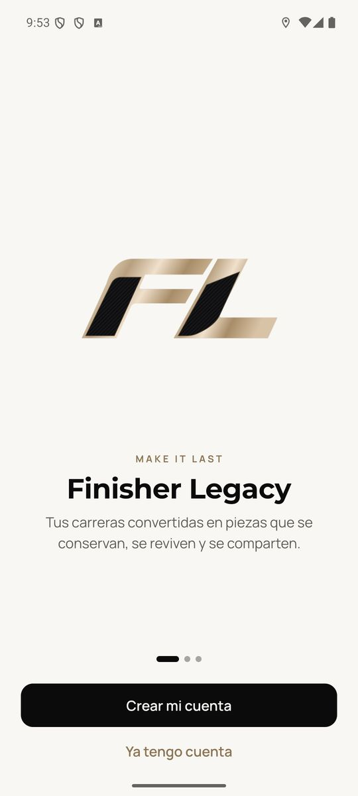
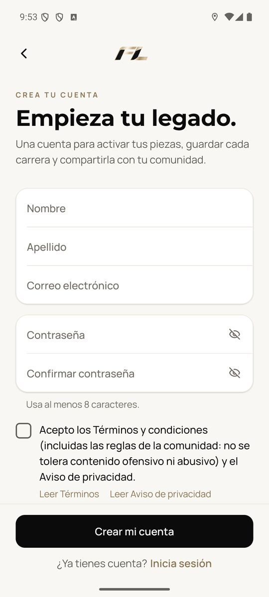

### Iniciar sesión y recuperar la contraseña

1. En la bienvenida toca **Ya tengo cuenta**.
2. Escribe tu correo y contraseña y toca **Entrar**. Si los datos no
   coinciden, la app lo dice arriba del formulario.
3. ¿La olvidaste? Toca **¿Olvidaste tu contraseña?**, escribe tu correo y toca
   **Enviar enlace**.
4. Abre el correo en el teléfono: el enlace abre la app en la pantalla para
   crear una contraseña nueva.

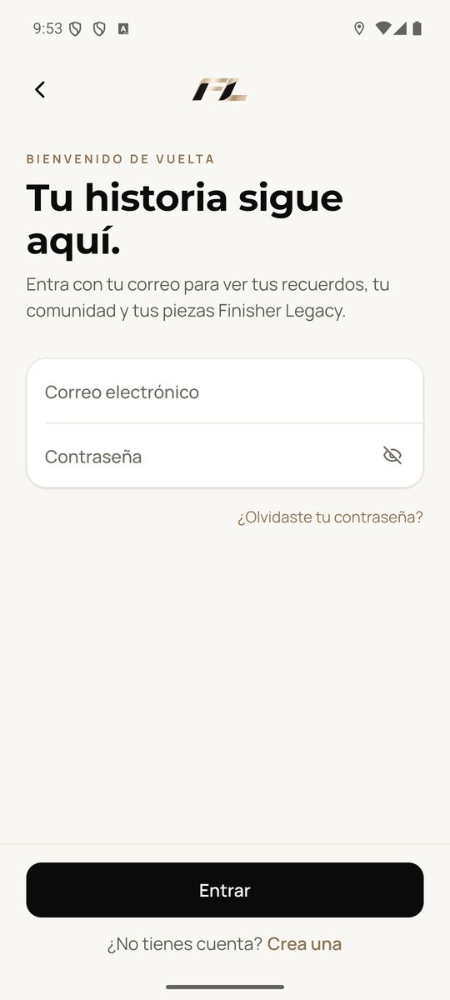
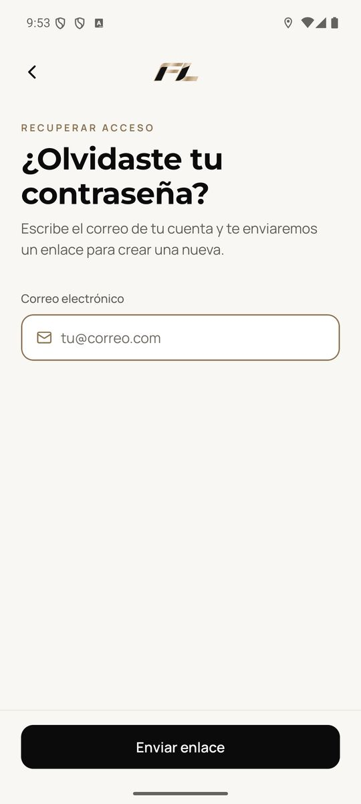

---

## 2. Navegación

La barra de abajo tiene cinco lugares:

| Botón | Qué hay |
|---|---|
| **Inicio** | Saludo, tu Legacy ID, accesos a activar y a Entrenamientos, pedidos pendientes y la lista de «Primeros pasos». |
| **Recuerdos** | Tus carreras, medallas, tu equipo (piezas conectadas) y tus recuerdos. |
| **Activar** (botón central) | Activar un Tag o una tarjeta de ánimo con NFC. |
| **Comunidad** | Feed, atletas para seguir, búsqueda y eventos. |
| **Colecciones** | La tienda: Finisher Legacy Tag, accesorios y equipo. |

1. Arriba a la derecha de Inicio están la **búsqueda**, las
   **notificaciones** (con un número si hay nuevas) y tu **avatar**.
2. Toca el avatar para abrir tu perfil; en tu perfil, el engrane abre la
   **Configuración**.
3. «Primeros pasos» te guía: completar el perfil, reclamar tu primera medalla,
   etc. Puedes ocultarla con la ✕.

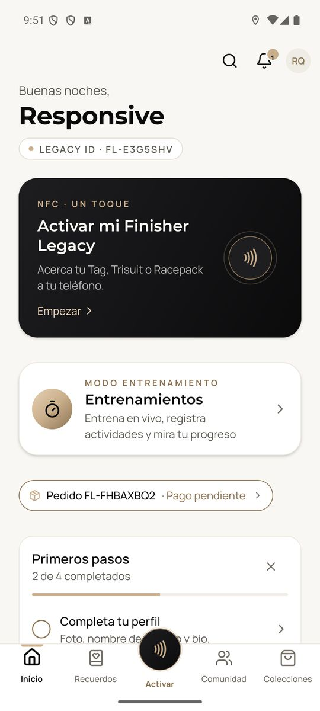

---

## 3. Activar un Finisher Legacy Tag con NFC

🔧 *Requiere un teléfono con NFC y el Tag real. Las capturas son del
emulador, que no tiene NFC.*

La app **escribe** en el chip el enlace permanente de tu pieza y lo verifica.
El asistente tiene 5 pasos: Cuenta · Código · Acercar · Activar · Listo.

1. Toca **Activar** (botón central) o **Activar mi Finisher Legacy** en
   Inicio. Si no has iniciado sesión, te pide entrar o crear cuenta.
2. Elige **Recuerdo Finisher Legacy** y escribe el **código de activación**
   de 12 caracteres que viene en la tarjeta dentro del empaque (los guiones se
   ponen solos). Toca **Continuar**.
3. Lee los consejos: NFC encendido, sin fundas metálicas o con imán, el Tag
   quieto. Toca **Estoy listo**.
4. Acerca el Tag al centro de la parte trasera del teléfono (en iPhone, a la
   parte superior) y no lo muevas hasta sentir la vibración. La app pasa por
   «Autorizando», «Escribiendo», «Verificando» y «Casi listo».
5. Al terminar se crea tu recuerdo y lo puedes abrir desde Recuerdos.

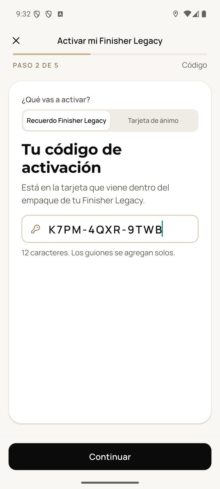
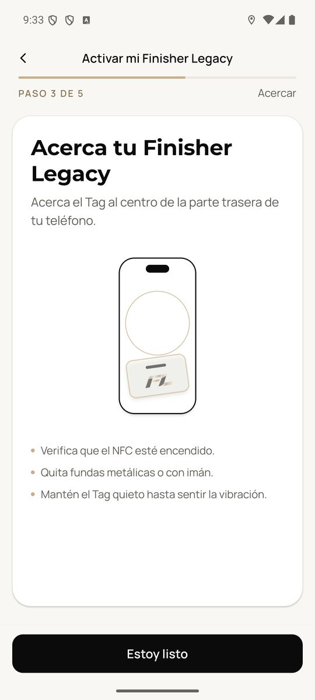

### Si algo falla

La app explica cada caso y **nunca escribe nada inesperado** en el chip:

| Mensaje | Qué hacer |
|---|---|
| Código no válido | Revisa los 12 caracteres de la tarjeta del empaque. |
| Tu teléfono no tiene NFC | Hazlo desde el teléfono de alguien de confianza iniciando sesión con tu cuenta (captura de abajo). |
| Activa el NFC de tu teléfono | Enciéndelo en los ajustes y vuelve. |
| No detectamos tu Finisher Legacy / Se movió antes de terminar | Acércalo de nuevo y mantenlo quieto unos segundos. |
| El chip no coincide con tu código / Es otro chip | Usa el Tag que venía en el mismo empaque. |
| Este Finisher Legacy ya está activado | Si es tuyo, está en tu Legacy; si no, escribe a hola@finisherlegacy.com. |
| Este chip está bloqueado / no es compatible / no tiene espacio | Escribe a hola@finisherlegacy.com. |
| Demasiados intentos | Espera unos minutos. |

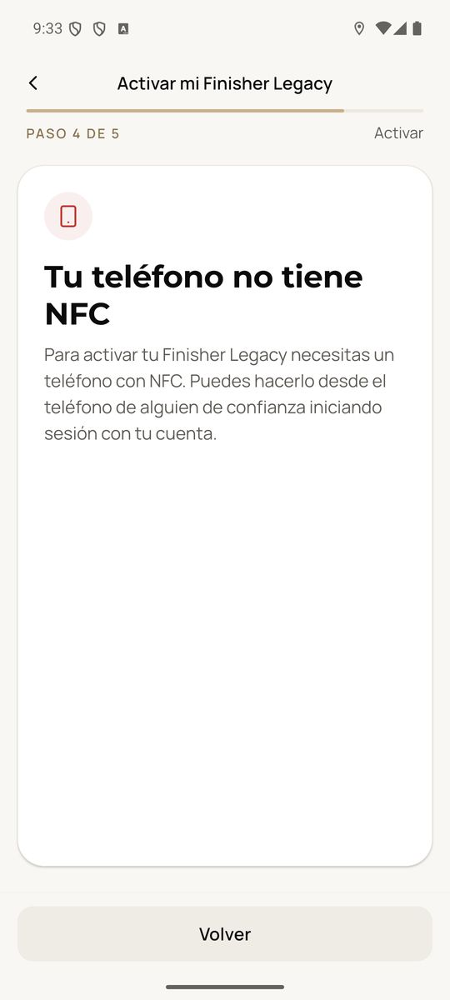

---

## 4. Mi Legado: recuerdos

Cada Tag activado tiene un **recuerdo**: la historia de esa carrera con sus
datos, fotos, videos y un mensaje de voz.

### Ver y editar un recuerdo

1. Abre **Recuerdos**. En «Mis recuerdos» desliza las tarjetas o toca
   **Ver N** para ver la lista completa.
2. Toca un recuerdo: arriba está la portada (la primera foto), el evento, la
   fecha y el lugar; abajo, tu tiempo, dorsal y distancia.
3. Debajo de la portada puedes **cambiar quién lo ve** (Privado, Con enlace o
   Público) y **protegerlo con NIP** (ver [§11](#11-nip-opcional)).
4. Toca **Editar** para cambiar los datos de la carrera y tu historia.

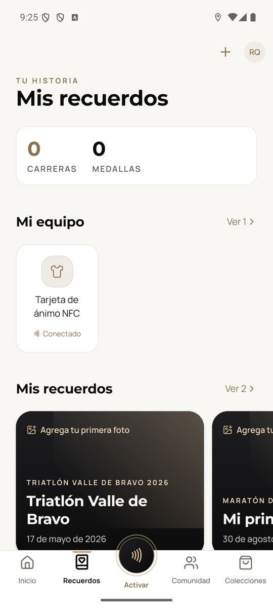
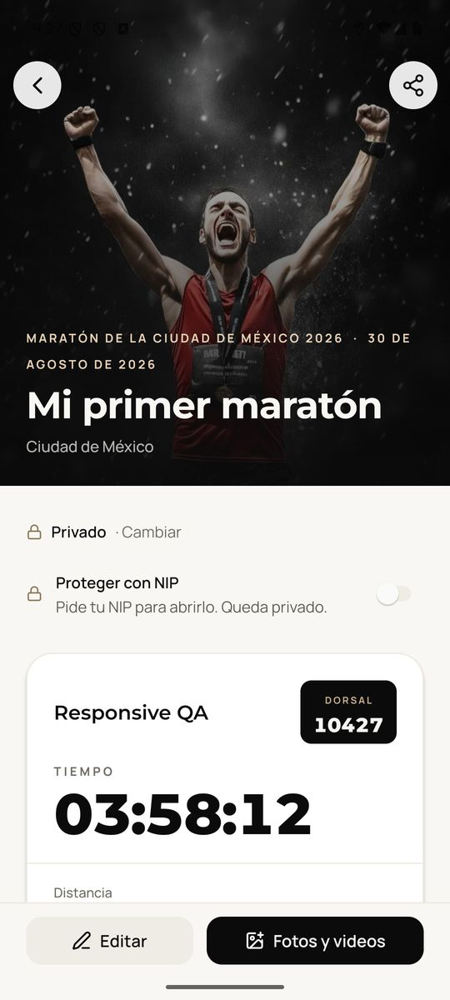

### Fotos, videos, portada y orden

1. Toca **Fotos y videos** (o **Administrar** en la sección de fotos).
2. Arriba ves cuánto espacio queda: fotos, video y mensaje de voz.
3. Toca **Agregar** y elige **Fotos de mi teléfono**, **Video de mi
   teléfono** (hasta 1 minuto) o **Fotos que compré** a los fotógrafos del
   evento. El mensaje de voz, por ahora, se agrega desde finisherlegacy.com.
4. Mientras se procesan, las fotos dicen «Procesando…».
5. **Portada y orden:** mantén presionada una foto y arrástrala. La primera es
   la portada.

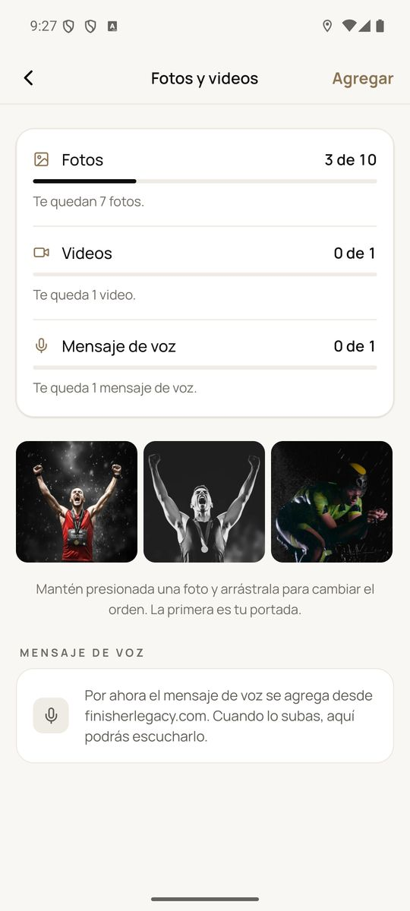

### Compartir

1. En el recuerdo, toca el ícono de compartir (arriba a la derecha) para
   mandar su enlace.
2. **Enlaces para compartir** crea un enlace distinto para cada persona (por
   ejemplo «Para mamá»), **aunque el recuerdo sea privado**. Puedes quitar un
   enlace cuando quieras.

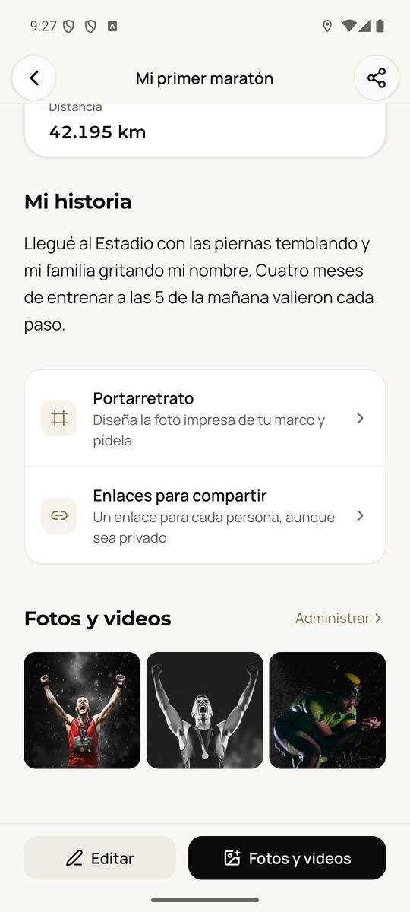

---

## 5. Portarretrato

El Portarretrato inteligente es un marco impreso de 20 × 25 cm con una foto y
los datos de tu recuerdo.

1. En el recuerdo toca **Portarretrato** («Diseña la foto impresa de tu marco
   y pídela»). Necesitas al menos una foto en el recuerdo.
2. **Diseña:** elige la foto principal, la plantilla (Carbono, Blanco hueso,
   Minimal…), qué datos se imprimen (nombre, carrera, lugar y fecha, tiempo,
   distancia, ritmo, posición, categoría, dorsal) y una dedicatoria. Lo que
   dejes vacío no aparece.
3. **Vista previa:** el recuadro de arriba muestra cómo se imprime y se
   actualiza con cada cambio.
4. Toca **Guardar diseño**. En «Tus diseños» puedes editarlo, eliminarlo o
   crear otro.
5. Toca **Pedir este portarretrato**: se agrega al carrito con tu diseño y
   sigues el pago normal de la tienda ([§13](#13-tienda-colecciones)).

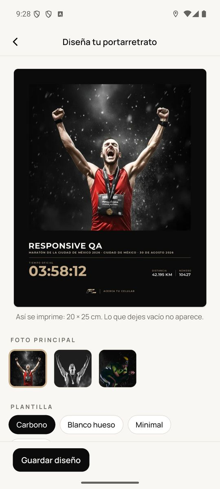
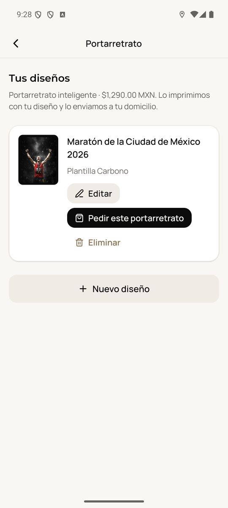

---

## 6. Medallas y carreras

### Medallas

1. En **Recuerdos** toca **Medallas** (o **Agregar una medalla**).
2. Toca **+**, agrega la foto frontal y, si quieres, la trasera (puedes
   recortarlas).
3. Escribe evento, fecha (AAAA-MM-DD), ciudad, país, distancia, tiempo
   oficial, ritmo y tu historia.
4. Elige quién puede verla (**Pública** o **Solo yo**) y toca **Guardar
   medalla**.
5. Desde el detalle (menú **•••**) puedes editarla o borrarla.

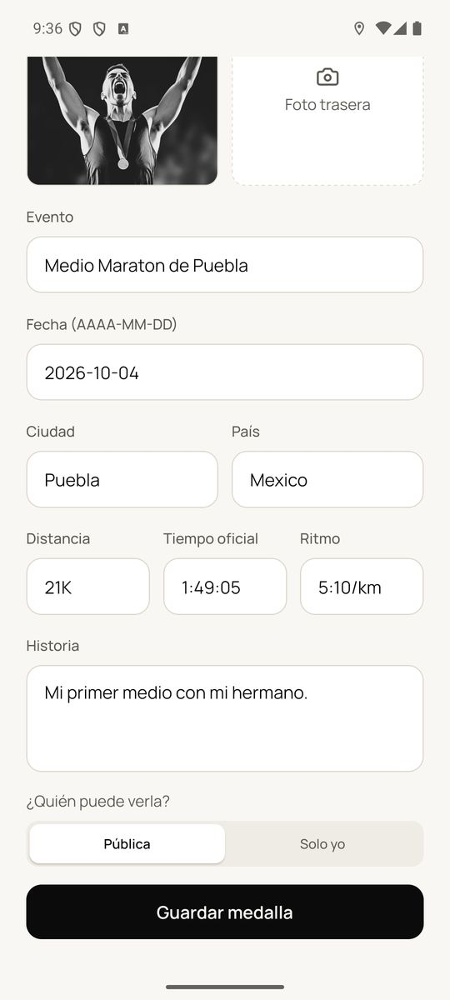
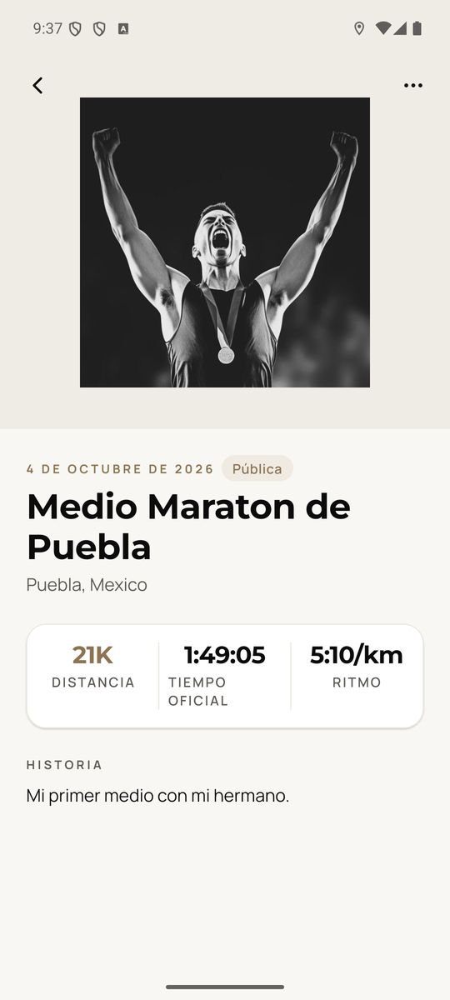

### Carreras

Cuando participas en un evento Finisher Legacy, tus resultados aparecen solos
en **Recuerdos** (contador «Carreras» y «Tu historia»). El día de la carrera,
**Entrenamientos › Seguir una carrera en vivo** permite que tu gente te siga
en el mapa (🔧 GPS en un teléfono real).

---

## 7. Modo entrenamiento

Se abre desde **Inicio › Entrenamientos**.

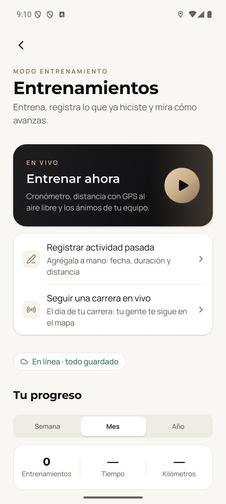

### Entrenar ahora

🔧 *La distancia con GPS solo se mide en un teléfono real al aire libre.*

1. Toca **Entrenar ahora**.
2. Elige la actividad (Running, Trail, Triatlón, Ciclismo, Natación, Obstacle
   Racing u Otros).
3. Elige **Al aire libre · GPS** (mide distancia; verás una notificación fija
   mientras mide, también con la pantalla bloqueada) o **Bajo techo · solo
   tiempo**.
4. Opcional: activa **Escuchar mis mensajes de ánimo**, el orden (nuevos
   primero, favoritos, todos) y cada cuánto suenan.
5. Toca **Empezar**. Pausa con el botón grande y termina con el cuadrado rojo:
   **Guardar entrenamiento**, **Seguir entrenando** o **Descartar**.

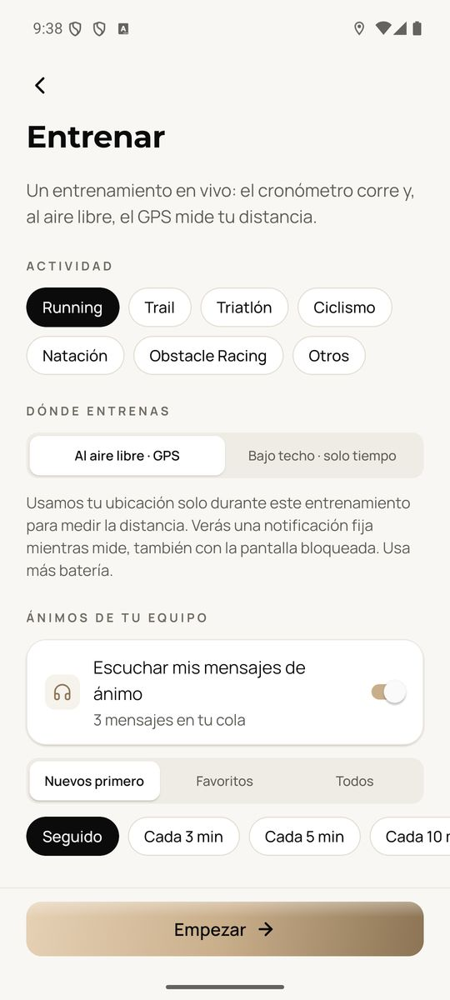
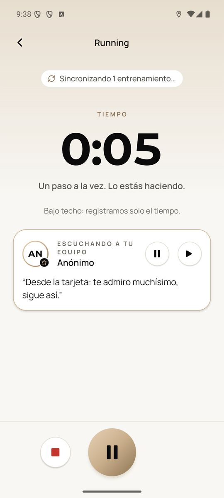

**Sin conexión:** el entrenamiento se guarda en el teléfono y se sincroniza
solo («Sincronizando…» → «En línea · todo guardado»).

**Sesión interrumpida:** si la app se cerró a medio entrenamiento, al volver
verás «Tienes un entrenamiento en curso» (o «en pausa») con **Continuar
entrenamiento**, **Terminar y guardar** o **Descartar**. Si quedó abierto en
otro dispositivo, aparece «Tienes un entrenamiento abierto en otro
dispositivo». Si quedó abierto mucho tiempo, el servidor lo cierra con los
últimos datos y lo marca «Cerrado automáticamente».

### Registrar una actividad pasada

1. Toca **Registrar actividad pasada**.
2. Elige actividad, día (flechas: Hoy, Ayer…) y hora de inicio.
3. Escribe la duración (horas y minutos) y, si la sabes, la distancia y unas
   notas.
4. Toca **Guardar actividad**. Queda marcada como «Manual» y **no cuenta para
   tus récords**.

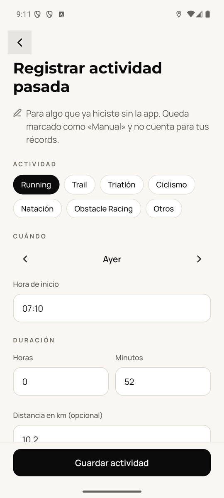

### Progreso, récords e historial

1. En Entrenamientos, «Tu progreso» resume la **Semana**, el **Mes** o el
   **Año**: entrenamientos, tiempo y kilómetros (dice cuántos fueron
   manuales).
2. «Tus récords» muestra mayor distancia, más tiempo, mejor 5 km y mejor
   10 km. Solo cuentan entrenamientos en vivo medidos con GPS; los de 5 y
   10 km son tu tramo más rápido real dentro de una ruta.
3. **Ver todo** abre el **Historial**, con filtros Todos · En vivo · Manual.
4. Toca un entrenamiento para ver tiempo, distancia, ritmo, tiempo en
   movimiento, desnivel, mejor 5 km, la ruta y tus notas. El bote de basura lo
   elimina.

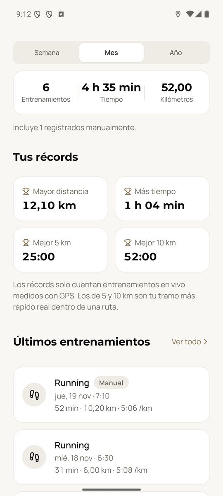
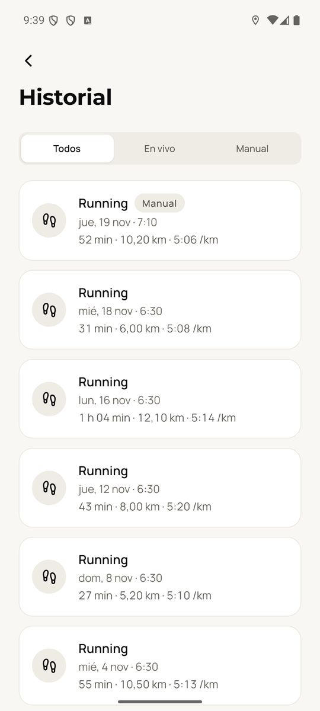

### Compartir como momento

1. En el detalle del entrenamiento toca **Compartir como Legacy Moment**.
2. Elige quién lo ve: **Solo yo**, **Seguidores** o **Público**.
3. Escribe un texto opcional y toca **Compartir**. Después aparece **Ver mi
   momento**.

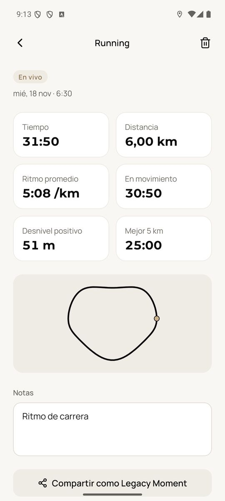
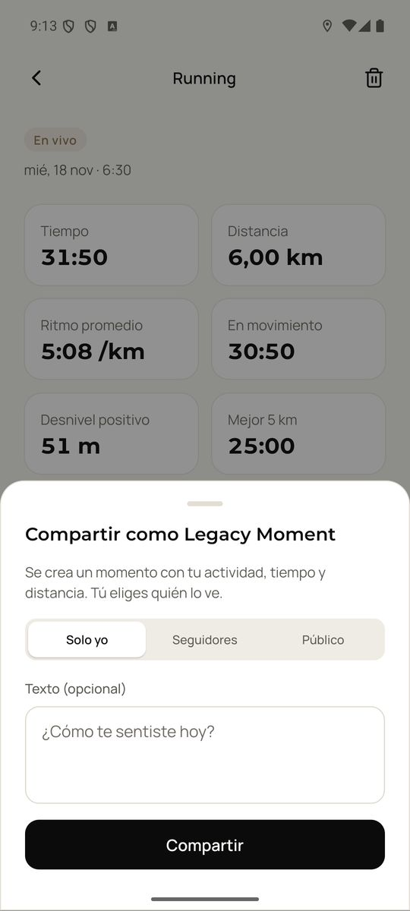

---

## 8. Mensajes de ánimo

Tu familia y amigos te mandan audios y mensajes **desde la web, sin crear
cuenta ni instalar la app**, y tú los escuchas mientras entrenas.

### Crear tu enlace «Envíame ánimo»

1. Abre **Entrenamientos › Mensajes de ánimo** y toca el ícono de enlace
   (arriba), o **Configuración › Mi equipo de apoyo**.
2. En «Nuevo enlace» escribe para qué entrenas (por ejemplo «Maratón de la
   CDMX») y por cuánto tiempo recibirás mensajes: 7, 30, 90 días o sin límite.
3. Toca **Crear y compartir** y mándalo por WhatsApp, Instagram o donde
   quieras.
4. En «Mis enlaces» ves cada enlace con su vigencia, cuántos mensajes lleva,
   cuántos gratis quedan («2 de 200 gratis») y sus tarjetas. Puedes
   compartirlo otra vez o borrarlo (bote rojo).

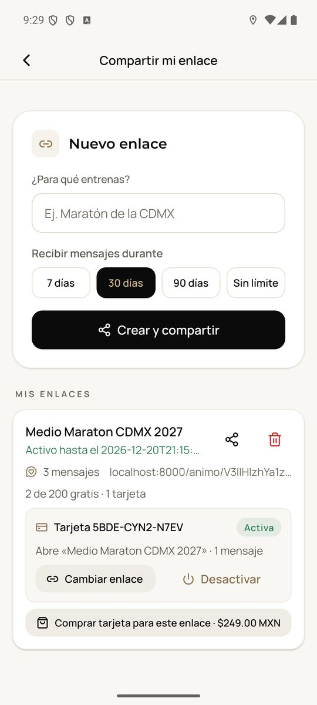

### Cómo graba la familia (sin app ni cuenta)

1. La persona abre el enlace en el navegador del celular: ve tu nombre y para
   qué entrenas.
2. Toca el micrófono y graba hasta 3 minutos (o sube un audio de hasta 10 MB).
3. Escribe su nombre, quién es para ti (Mamá, Papá, Pareja…), unas palabras
   opcionales y elige un ícono.
4. Toca **Enviar a {tu nombre}**. Solo tú podrás escucharlo.

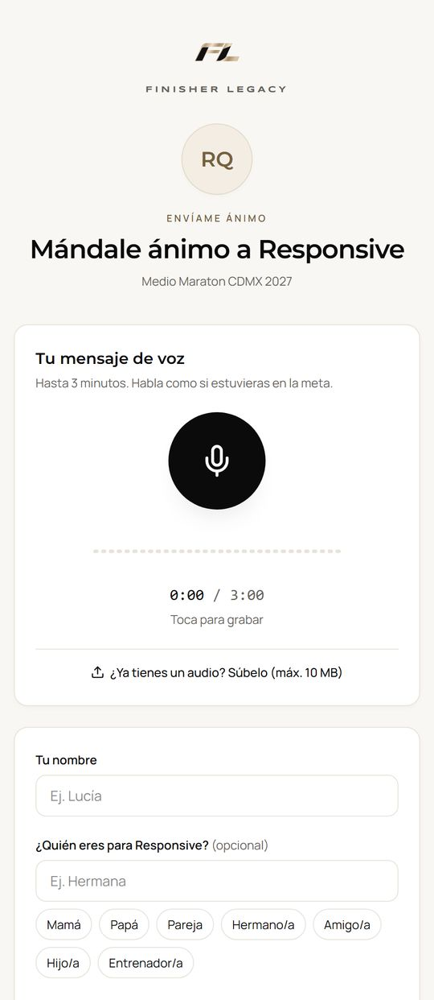

Si la administración lo permite, aparece **Enviar como anónimo** y tú verás
«Anónimo». Si el mensaje no es gratis, la página muestra el precio **antes de
grabar** (ver [§9](#9-tarjeta-de-ánimo-nfc)).

### Escuchar

1. En **Mensajes de ánimo** ves los nuevos, favoritos y el total, con filtros
   Todos · Sin escuchar · Favoritos.
2. Desliza un mensaje a la izquierda o mantenlo presionado para guardarlo en
   favoritos. Puedes ocultar o bloquear a un remitente.
3. **Descargar todos** los deja disponibles sin conexión.
4. Toca **Entrena con tu equipo** (o activa los ánimos al empezar un
   entrenamiento): los mensajes suenan mientras entrenas, también con la
   pantalla bloqueada (🔧 probar en teléfono real).

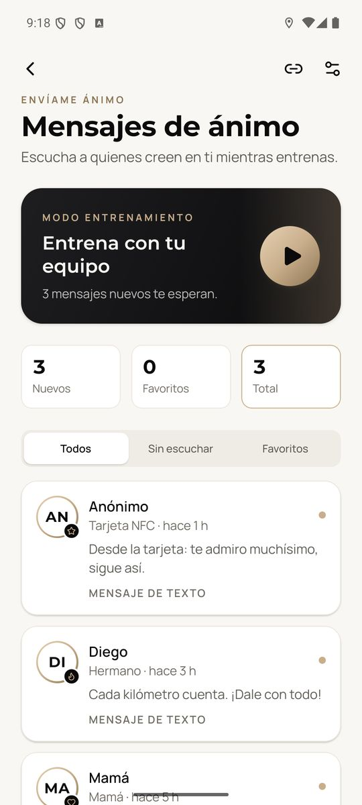

---

## 9. Tarjeta de ánimo NFC

Una tarjeta física con chip NFC. Quien la tiene la **acerca a su celular** y
se abre en el navegador la página para dejarte un mensaje de voz, sin cuenta y
sin app. **Cada vez que la acercan pueden dejar otro mensaje.** Ideal para
regalársela a mamá, a los abuelos o a tu entrenador.

### Comprarla

1. En **Mis enlaces**, toca **Comprar tarjeta para este enlace** en el enlace
   que quieras (puedes crear uno nuevo, por ejemplo «Para mamá»). Se agrega al
   carrito y la línea dice «Abre: {enlace}».
2. Paga como cualquier pedido. Puedes pedir el envío a tu domicilio o al de tu
   familiar.
3. Al surtir el pedido, Finisher Legacy liga la tarjeta a ese enlace: **llega
   lista para usarse**.
4. También está en **Colecciones › Tarjeta de ánimo NFC**. Comprada desde ahí
   llega sin enlace y la vinculas tú en la app (paso siguiente).

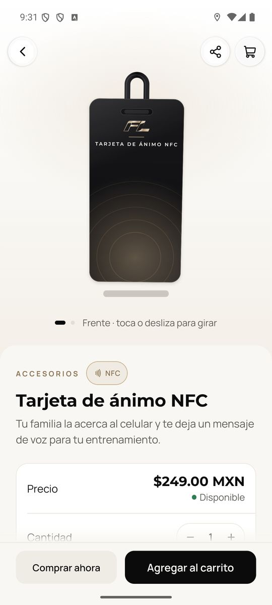

### Activarla o cambiarla de enlace

🔧 *Activar requiere un teléfono con NFC y la tarjeta real.*

1. Toca **Activar** y elige **Tarjeta de ánimo**.
2. Elige qué enlace abrirá (o escribe uno nuevo y toca **+**).
3. Escribe el código de activación del empaque y sigue los mismos pasos que un
   Tag ([§3](#3-activar-un-finisher-legacy-tag-con-nfc)). Al terminar, **Ver
   mis tarjetas**.
4. En **Mis enlaces** cada tarjeta muestra «Activa», a qué enlace abre y
   cuántos mensajes dejó. **Cambiar enlace** la liga a otro de tus enlaces;
   **Desactivar** hace que al acercarla se vea «Esta Tarjeta de ánimo no está
   activa» (la puedes volver a vincular cuando quieras).

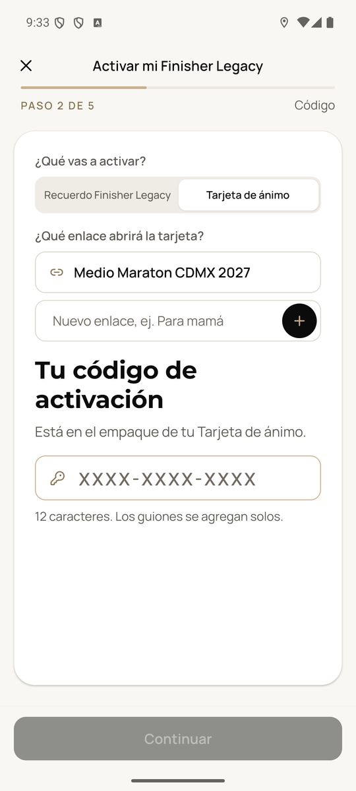

### Mensajes gratis y de pago

Lo decide la administración, por separado para enlaces y para tarjetas:

- Cuántos mensajes son **gratis** por enlace y por tarjeta.
- Qué pasa después: **no aceptar más**, **seguir gratis** o **cobrar**.
- Si se cobra, **paga quien envía el mensaje**, en su navegador, con tarjeta
  (OpenPay). Puede haber paquetes de varios mensajes. El mensaje solo te llega
  cuando el pago se confirma; si no se paga a tiempo, se borra.
- Si se permiten **mensajes anónimos**.

En la app, los mensajes que llegaron por la tarjeta dicen **«Tarjeta NFC»**.

🔧 *Los mensajes de pago requieren las llaves de OpenPay; sin ellas la página
avisa que por ahora no se pueden cobrar mensajes adicionales.*

---

## 10. Familia y ubicación en vivo

Ser familia **no** da acceso permanente a tu ubicación: tú eliges con quién
compartir y por cuánto tiempo.

### Invitar y aceptar

1. **Configuración › Familia › Invitar a alguien**.
2. Escribe quién es para ti (opcional: «Mamá», «Mi pareja»…) y su correo si
   ya tiene cuenta, y toca **Enviar invitación**. Si no tiene cuenta, toca
   **Crear enlace para compartir** (el enlace dura 7 días).
3. Queda «Pendiente · Esperando que acepte». La otra persona recibe un aviso
   (o abre el enlace) y toca **Aceptar** o **Rechazar**.
4. Toca a un familiar para cambiar su etiqueta o quitarlo. Las invitaciones
   que te hagan a ti aparecen en la misma pantalla.

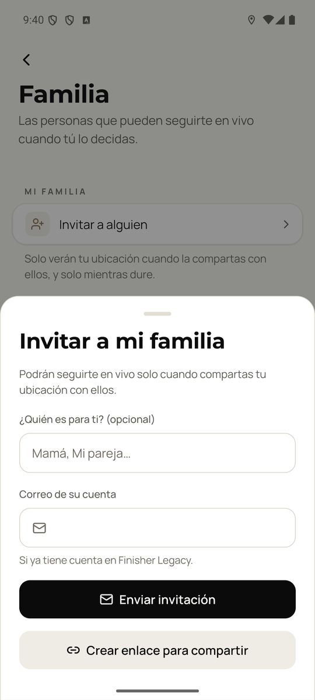
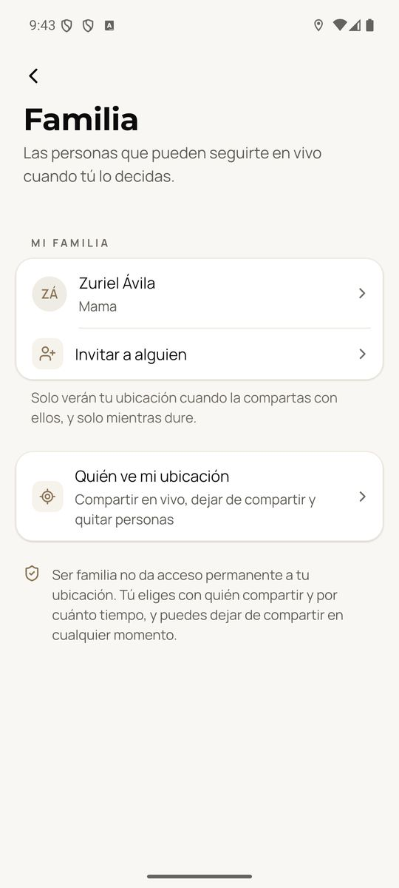

### Compartir y dejar de compartir tu ubicación

🔧 *Requiere un seguimiento en vivo en curso con GPS en un teléfono real.*

1. Inicia el seguimiento en vivo (Entrenamientos › Seguir una carrera en
   vivo, o un entrenamiento al aire libre).
2. Abre **Familia › Quién ve mi ubicación** (también desde la pantalla de
   seguimiento) y toca **Compartir ubicación**.
3. Elige con quién: **Toda mi familia**, algunas personas y/o un **Enlace
   público** para quien no tiene cuenta.
4. Elige por cuánto tiempo: **Hasta que termines**, **2 h**, **6 h** o
   **24 h**. Tu familia recibe un aviso y te ve en el mapa.
5. **Dejar de compartir ahora** corta a todos de inmediato; también puedes
   quitar a una sola persona. Al detener el seguimiento, todos dejan de verte
   automáticamente.

---

## 11. NIP opcional

Protege con un NIP de 4 a 6 números los recuerdos, momentos y fotos que tú
elijas. **Nadie más, ni el equipo de Finisher Legacy, puede abrirlos.**

1. **Activar:** Configuración › Contraseña y cuenta › **Protección con NIP**
   › Activar protección con NIP. Crea tu NIP y confírmalo.
2. **Proteger un recuerdo:** en el recuerdo activa **Proteger con NIP**.
   Queda privado al instante (al quitar la protección sigue privado hasta que
   cambies su visibilidad).
3. **Desbloquear:** al abrir algo protegido verás «Recuerdo protegido» y
   **Desbloquear**. El desbloqueo dura 10 minutos o hasta que salgas de la
   app.
4. **Intentos:** después de 5 errores el NIP se bloquea unos minutos (cada
   vez más) y la app muestra la cuenta regresiva.
5. **¿Olvidaste tu NIP?** Restablécelo con tu contraseña o con un código de
   6 dígitos que llega a tu correo (para cuentas de Google o Apple). Tus
   elementos siguen protegidos y te llega un correo de aviso.
6. **Cambiar NIP** pide el actual; **Desactivar protección** quita el NIP
   (lo protegido sigue privado).

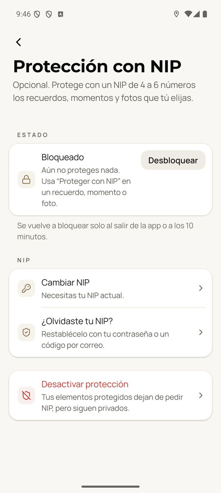
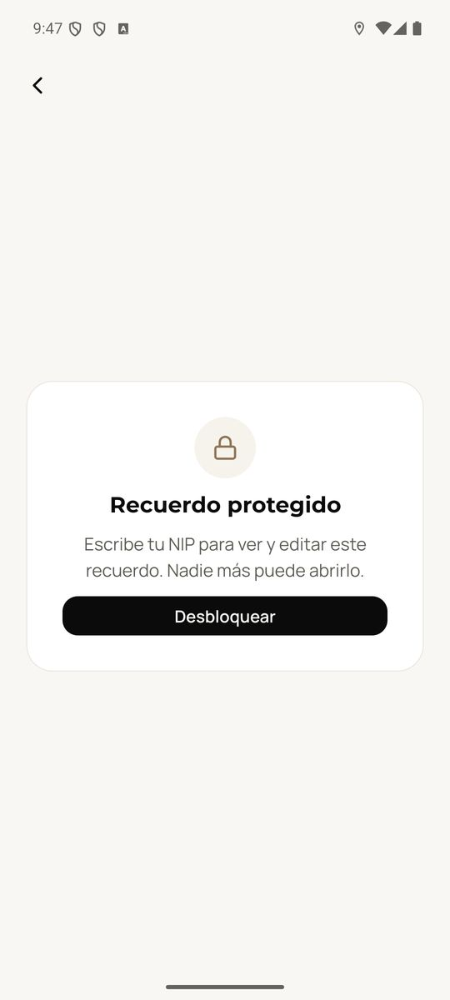

---

## 12. Comunidad

1. **Feed:** en **Comunidad**, la pestaña **Siguiendo** muestra los momentos
   de quien sigues y los tuyos; **Descubrir**, lo más reciente; **Eventos**,
   los eventos. Arriba hay atletas sugeridos.
2. **Seguir:** toca **Seguir** en un atleta sugerido, en su perfil o desde la
   búsqueda (lupa).
3. **Reaccionar y comentar:** en un momento toca el corazón o el ícono de
   apoyo, o el globo para dejar un **mensaje de apoyo**.
4. **Publicar:** el **+** de Comunidad crea un momento; también puedes
   compartir un entrenamiento ([§7](#7-modo-entrenamiento)).
5. **Bloquear y reportar:** en el perfil de un atleta (o en un momento) toca
   **•••** y elige **Reportar perfil** o **Bloquear**. Los bloqueados se
   administran en Configuración › Privacidad y bloqueos.
6. **Visibilidad:** cada momento es para Todos, Seguidores o Solo yo. En
   **Privacidad** puedes hacer tu perfil privado.

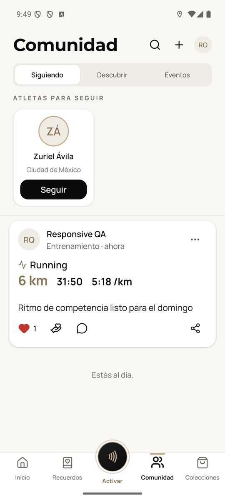
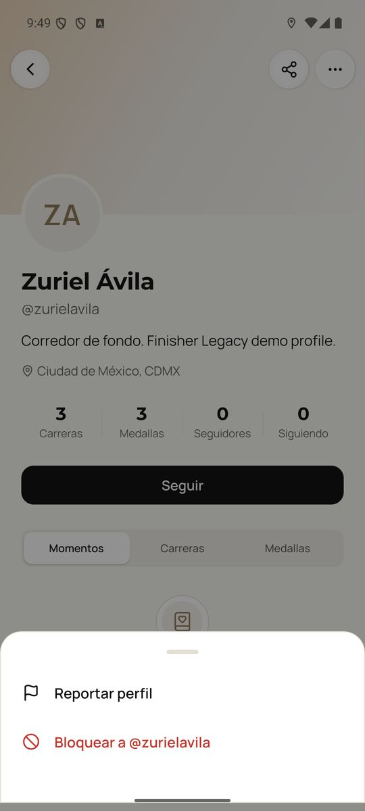

---

## 13. Tienda (Colecciones)

1. **Catálogo:** en **Colecciones** busca o filtra por Todo, Accesorios,
   Equipo, Finisher Legacy Tag…
2. **Producto:** toca un producto para ver fotos (algunos giran al deslizar),
   precio y existencias. Elige cantidad y toca **Agregar al carrito** o
   **Comprar ahora**.
3. **Carrito:** cambia cantidades, borra productos o aplica un cupón. Si algo
   ya no tiene existencias, el carrito lo marca y no deja continuar hasta
   quitarlo. Toca **Continuar al pago**.
4. **Entrega:** elige **Recoger en evento o punto de entrega** o **Envío a
   domicilio** (escribe la dirección). El costo de envío lo calcula el
   servidor.
5. **Pago seguro** 🔧: toca **Pagar**. Se abre una ventana segura del banco
   (OpenPay); si tu banco pide verificarte, lo haces ahí. Los datos de la
   tarjeta nunca se guardan en la app. Sin llaves de OpenPay, la app muestra
   «Pago en línea no disponible» y el pedido queda guardado en Mis pedidos.
6. **Pedidos:** en Colecciones toca el ícono de recibo (Mis pedidos). Cada
   pedido muestra su avance (creado, pago pendiente, preparando, entregado),
   productos y entrega. Un pedido **sin pagar** se puede **Pagar** o
   **Cancelar pedido**; queda apartado por un tiempo limitado.

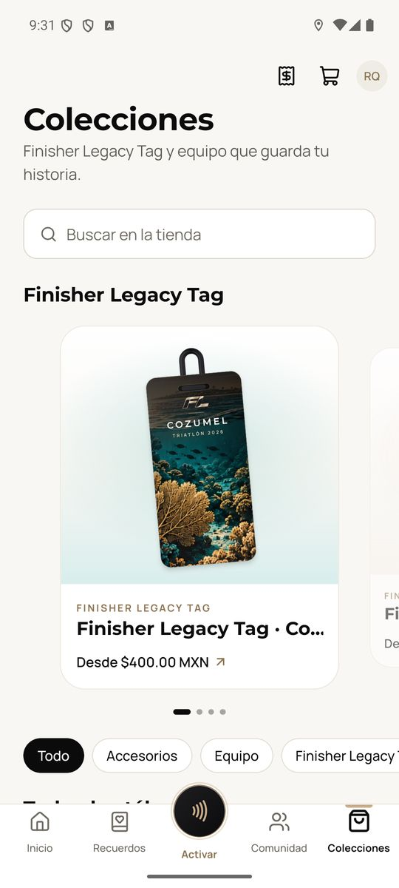
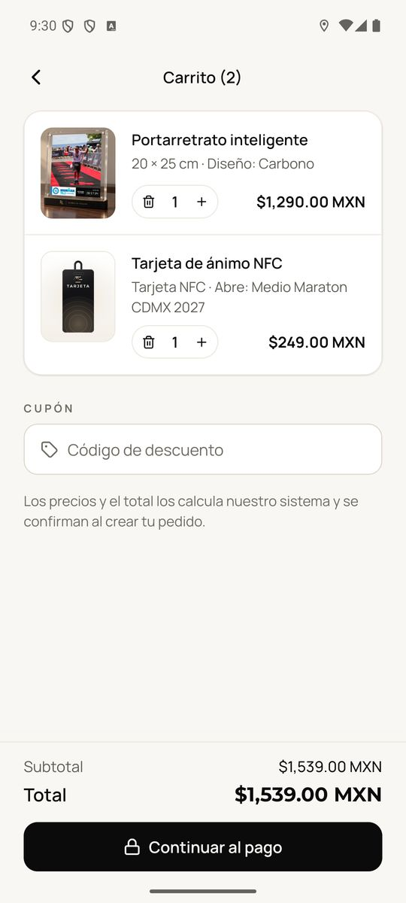
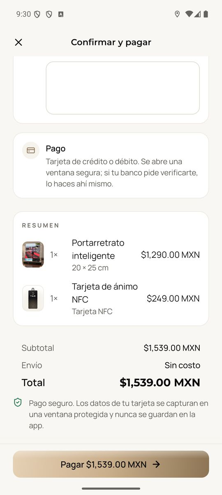
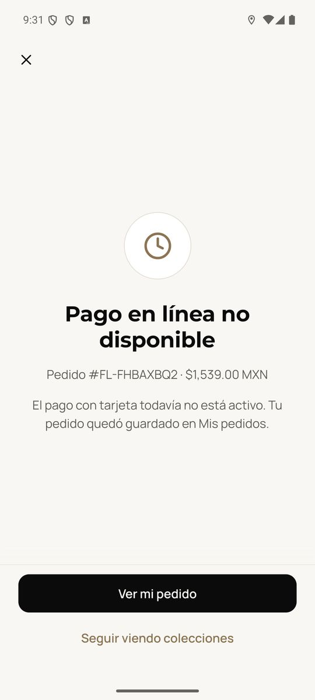
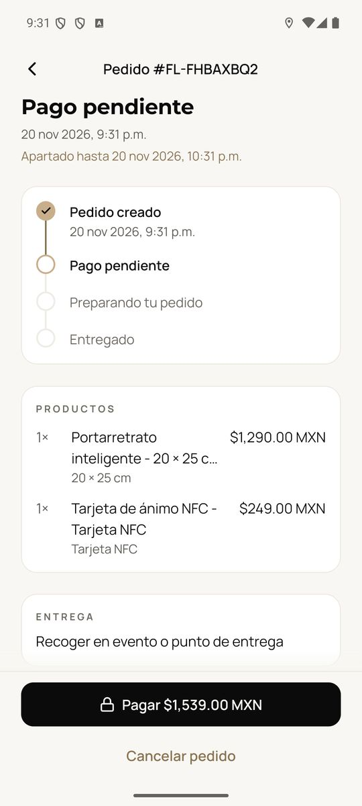

---

## 14. Notificaciones y ajustes

### Notificaciones

1. La campana de Inicio abre tus avisos; la doble palomita los marca todos
   como leídos. Tocar un aviso abre lo que corresponde.
2. **Configuración › Notificaciones**: activa las notificaciones push en este
   teléfono y elige qué te avisamos, en la app y por push (🔧 push solo en
   teléfono físico).

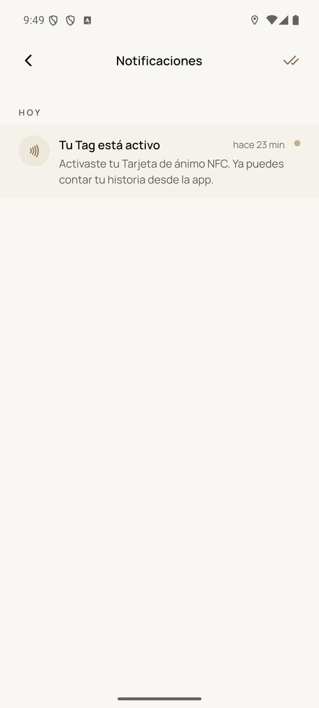

### Ajustes

1. **Idioma:** Configuración › Idioma › **Español** o **English**. Cambia al
   momento.
2. **Privacidad:** perfil privado, atletas bloqueados, Política de privacidad
   y Términos.
3. **Contraseña y cuenta:** cambiar contraseña (te enviamos un enlace
   seguro), Protección con NIP y **Eliminar mi cuenta**.
4. **Eliminar la cuenta:** toca **Eliminar mi cuenta**, escribe la palabra que
   pide la app y confirma con tu contraseña (o **No tengo contraseña** si
   entraste con Google o Apple). Se borran tu perfil, momentos y actividad
   social.
5. **Ayuda:** Escríbenos (hola@finisherlegacy.com), Acerca de y **Cerrar
   sesión**.

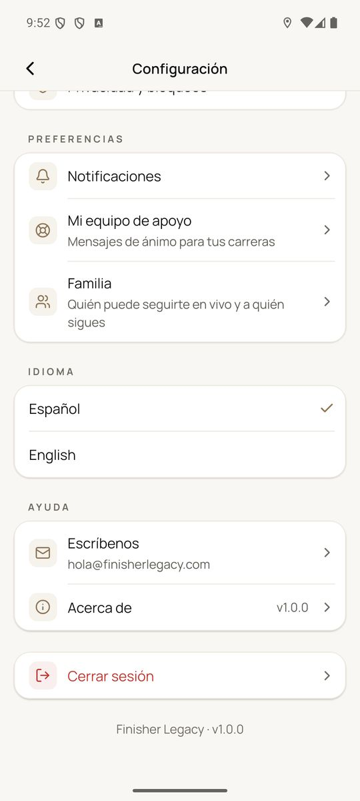
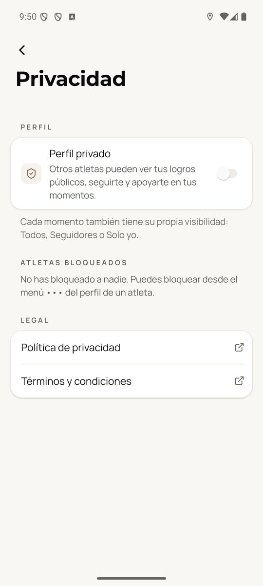
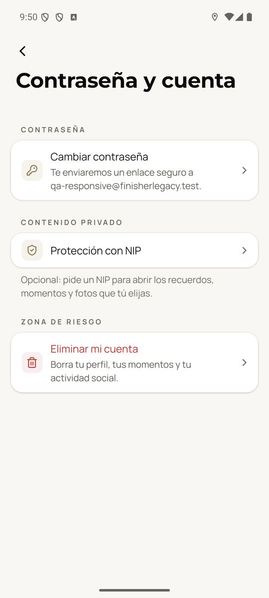

---

## 15. Para el administrador

Pantallas del panel (`/admin`) relacionadas con estos flujos:

| Tema | Dónde | Para qué |
|---|---|---|
| Mensajes de ánimo | **Ventas › Límites y tarifas › Mensajes de ánimo** (`/admin/limites-y-tarifas/mensajes-de-animo`, permiso `quotas.manage`) | Por canal (enlace y tarjeta): mensajes gratis, qué pasa después (bloquear, gratis o cobrar), tope, precio, precios escalonados, paquetes y anónimos. Muestra conteos (gratis, pagados, de paquete, esperando pago, cobrado) y avisa si OpenPay no está configurado. El personal **nunca** lee los mensajes. |
| Pedidos | **Ventas › Pedidos** | Surtir, cancelar y reembolsar. En una tarjeta de ánimo se ve el enlace que abrirá y las piezas asignadas; al surtir, la tarjeta se liga sola a ese enlace. En un portarretrato, el archivo de producción. |
| Tags | **Inventario › Unidades NFC** (`/admin/tags`) | Inventario de Tags y tarjetas (insignia «Tarjeta de ánimo» y a qué enlace abre `/t/{código}`), estados y desactivar piezas extraviadas o robadas. Los lotes se reciben en **Inventario › Lotes**. |
| Comunidad | **Contenido › Comunidad y moderación** (`/admin/community`) | Revisar reportes, advertir o suspender. Lo protegido con NIP aparece como «Contenido protegido con NIP». |
| Productos | **Catálogo › Productos** | Precio y fotos de la tarjeta de ánimo y del portarretrato. |

Detalle técnico de cada módulo: [FUNCIONALIDADES.md](FUNCIONALIDADES.md) y
`docs/renovacion/` (en especial `tarjeta-animo.md`, `familia.md`, `nip.md`,
`entrenamientos.md` y `pagos.md`).
